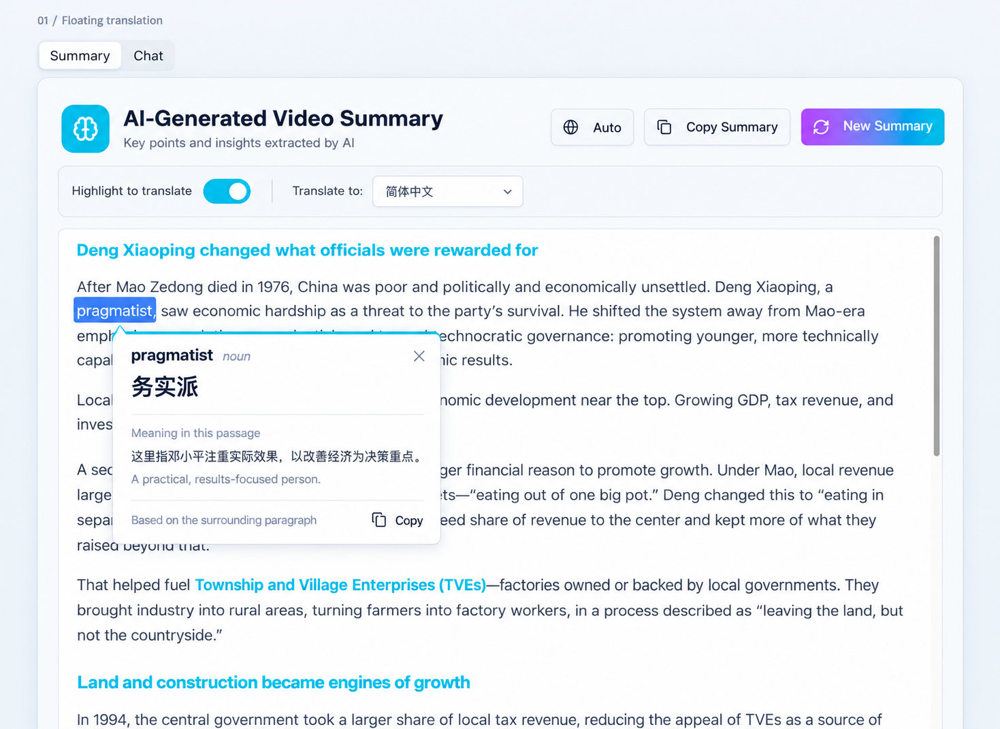
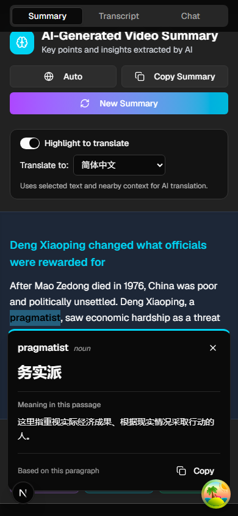

# Highlight translation with a floating card

## Status

Approved for implementation by the product owner through the explicit $implement request, with the subsequent correction that access is paid-only.

## Product intent

Help a Learner understand an unfamiliar expression while reading a Summary, without leaving the passage. A Highlight Translation explains the selected expression in its surrounding paragraph; it does not verify the Summary's factual claims.

For the passage about Deng Xiaoping, selecting “pragmatist” with Simplified Chinese selected should produce “务实派” and a short explanation that he emphasizes practical results and economic improvement. Equivalent natural translations are acceptable; the explanation must match the passage.

## Approved decisions

| ID | Decision |
| --- | --- |
| D1 | Use the floating card shown in the selected design. |
| D2 | Offer the feature in the Summary tab only for the first release. |
| D3 | Start “Highlight to translate” off and remember the Learner's switch choice. |
| D4 | Support words, phrases, and selections up to one sentence. Whole-paragraph translation is outside this release. |

The mockup uses Simplified Chinese as an example. It does not establish a fixed default language.

## Approved behavior

### Language and preferences

Use a separate translation-language selector. Initially choose the browser's first supported language, falling back to English; subsequently restore the last choice. Reuse the existing 18-language list, including separate Simplified and Traditional Chinese choices. Store only the switch and language preferences in this browser; account synchronization is outside this release. Keep the existing Summary-language “Auto” behavior unchanged.

Show the selected text, its translation, and one or two short sentences explaining its meaning in the selected target language. Part of speech may appear for a single word when useful. When source and target language match, provide a contextual explanation labeled “Meaning in this passage.” If context cannot resolve ambiguity, say so briefly rather than inventing a confident meaning.

### Selection and card behavior

On desktop, translate automatically once a mouse or keyboard selection has settled. Process selections wholly inside the currently displayed Summary. Ignore empty selections, interface labels, controls, and input fields. Allow at most one sentence within one paragraph and 500 Unicode characters; larger selections receive a short “Select up to one sentence” hint without an AI call. Recognize sentence boundaries across supported languages and common abbreviations.

Anchor one card near the selection, keeping it within the viewport and clear of the selected text. Show a loading state immediately. A new selection replaces the previous card; a late response for an older selection must never replace the current result. Turning the feature off, changing the Summary, or leaving the tab dismisses the card and invalidates pending results.

Provide Copy and Close controls. Copy writes the translation and contextual explanation; ordinary browser copying continues to copy selected source text. Close, Escape, and clicking outside dismiss the card. Scrolling or resizing keeps the card attached while the selection remains visible and dismisses it when its anchor leaves view. Preserve keyboard focus, readable contrast, screen-reader status announcements, and native selection controls.

On touch devices, use a small Translate action after selection settles; tapping it opens the same card. This keeps selection-handle adjustments from immediately opening a card. A failed request stays in the card with a concise explanation and an explicit Retry action. Do not silently retry or substitute a generic dictionary result.

### Context and privacy

Use only the selection, the containing Summary paragraph, and the nearest section heading when present. Bound paragraph context to 4,000 Unicode characters around the selection and the heading to 200. Do not retrieve the full Transcript, other Videos, Chat messages, or unrelated page content for this feature.

Explain next to the control: “Uses selected text and nearby context for AI translation.” Send necessary text through the existing server AI integration. Do not save translation history or put selected text, context, translations, or raw provider errors in logs or analytics. Provider retention is governed by the configured service; the interface must not promise unverified zero retention or no-training terms. Review the existing privacy disclosure for this added use before release.

Treat selected text and context as content to translate, including when they contain instructions. Render validated plain text. Check the caller's access to the source Summary on every request, bound input and output, and keep provider credentials on the server.

### Access and usage

Restrict access to signed-in users with an active paid entitlement. Free and anonymous users cannot invoke translation. A translation consumes no Summary-generation allowance. Reuse the existing shared authenticated limit of 30 AI requests per minute; translations count against that same shared limit, not an additional 30-request allowance. A rate limit displays a retry time and sends no AI request. Sign-in and service failures produce explicit card states. Anonymous translation, a separate paid tier, and a monthly translation allowance are outside the proposed first release.

## Alternatives and non-goals

The floating card preserves the reading column and places the answer near the selected text, at the cost of temporarily covering nearby text. The sidebar provides more explanation space but narrows the Summary. The inline design avoids overlays but moves the reading content. The Learner selected the floating card.

Video Chat translation, whole-paragraph or whole-Summary translation, saved vocabulary, pronunciation audio, translation history, external dictionary navigation, new YouTube data acquisition, and account-synced preferences are outside this release. No ADR is needed for these reversible UI choices.

## Acceptance criteria

1. With the switch off, ordinary selection works and produces no translation request. Its state is restored according to the approved preference policy.
2. With the switch on, a valid desktop selection opens the anchored card automatically; the approved touch interaction works without disabling native copy controls.
3. “Pragmatist” in the supplied passage yields a natural translation and an explanation of its practical, results-oriented meaning in context. A word with different meanings in two passages receives the appropriate meaning for each.
4. The translation language can differ from the Summary language; changing it invalidates the old card, affects subsequent results, and never regenerates the Summary.
5. Empty, out-of-scope, cross-paragraph, overlong, and multi-sentence selections produce no AI call. Punctuation, abbreviations, and Chinese text have representative selection tests.
6. Rapid selection changes, language changes, dismissal, disabled state, tab changes, and Summary replacement cannot display a stale result.
7. The card remains usable near viewport edges and in both mobile page scrolling and desktop Summary scrolling. Keyboard, touch, Escape, Copy, and screen-reader behavior are verified.
8. Loading, ambiguous meaning, same-language meaning, provider failure, sign-in failure, and rate limits have clear states. Retry is explicit.
9. The approved access policy is enforced server-side; translations do not reduce Summary allowances. Existing shared rate limits still apply.
10. Requests contain only bounded, authorized Summary context. Injection-like source text remains data, model output cannot inject HTML, and telemetry excludes content and provider error bodies.

## Final decisions

| Question | Recommended answer | Status |
| --- | --- | --- |
| Q4 | Initialize from browser language; remember target and switch locally. | Approved for implementation. |
| Q5 | Paid users only; no Summary charge; shared 30 AI requests/minute. | Approved for implementation. |
| Q6 | Explicit Translate action on touch; automatic translation on desktop. | Approved for implementation. |

The implementation request approves the behavior and acceptance criteria above. Paid-only access supersedes the earlier Free-and-Pro recommendation.

## Existing implementation references

- [Summary language control](../../app/summary/components/language-picker.tsx): “Auto” means the Video's native Summary language.
- [Summary reading surface](../../app/summary/components/summary-content.tsx): distinct mobile page-scroll and desktop contained-scroll behavior.
- [Supported languages](../../lib/constants/languages.ts) and [browser locale matching](../../lib/utils/browser-locale.ts).
- [Summary entitlements](../../lib/services/entitlements.ts): Summary-generation allowances are separate from this proposed feature.
- [Shared rate limiter](../../lib/services/rate-limit.ts), [AI integration](../../lib/services/llm-client.ts), and [content-free observability rules](../../lib/observability.ts).

## Implementation verification

- Full unit and integration suite: 378 files / 3,570 tests passed with coverage; line coverage 88.41%.
- Final focused API/UI regressions: 48 tests passed, including paid-only enforcement, stale responses, native touch cancellation, and sentence boundaries.
- Repository lint and TypeScript checks passed.
- Browser contract: 30 checks passed across ten repetitions. Coverage includes desktop Copy/Escape/tab changes, paid-only controls, and the mobile Translate action. AI responses are fixtures in these tests.
- Separate opt-in live smoke: `smoke-tests/e2e-highlight-translation-live.spec.ts`. After deployment, set `RUN_LIVE_HIGHLIGHT_TRANSLATION=1`, `BASE_URL` and `PROD_URL` to the deployment, and provide the existing dedicated `TEST_LIVE_SUMMARY_EMAIL` / `TEST_LIVE_SUMMARY_PASSWORD` credentials. It exercises real auth, saved Summary access, and AI without interception. It has not been run against production before release.

### Standards review

Three findings were fixed: add the live smoke, preserve terminal abbreviation boundaries, and use semantic typography. Follow-up review found no remaining issues.

### Spec review

Two findings were fixed: recover cancelled touch pointer sequences and recognize representative abbreviation boundaries. Follow-up review found no remaining issues.

### Implemented desktop and mobile views

These screenshots show the real UI with deterministic translation responses.

## Heading-selection regression (2026-10-21)

The Learner reported that selecting “controversy” in “What the controversy is about” showed the invalid-selection hint. Headings were missing from both the browser selection markers and the server passage verifier. Summary headings are selectable content: support all six heading levels and both Markdown heading syntaxes, using the selected heading itself as the bounded local context and section heading. Keep the existing sentence/character limits, paid-only checks, and exact saved-Summary verification. A selection that crosses from a heading into a paragraph remains invalid. Card copy refers to a “passage” so it also describes heading selections accurately.

Regression evidence: the Summary UI test reproduced the exact hint; changing only the Markdown from heading to paragraph passed. The API regression returned 409 before the fix and 200 after it. UI/API coverage checks heading formats, selection offsets, forged context, and cross-block rejection; a browser regression exercises native double-click selection of “controversy”.

Validation: 67 focused UI/API tests passed; the full 378-file / 3,594-test suite passed with 88.44% line coverage. TypeScript and changed-file lint passed. Independent Standards and Spec reviews found no actionable issues.

The broader browser stress run also encountered intermittent selection/card dismissal in the existing mobile paragraph test. That behavior remains unresolved; this correction changes heading recognition and leaves the mobile selection lifecycle unchanged.

## Translation-response regression (2026-10-21)

The Learner reported intermittent failures when selecting a valid sentence. Repeating the same sentence against production produced both 200 and 502 responses. Content-free diagnostics identified a rejected result with `source: sameLanguage` and `reason: missing`: an auxiliary model flag caused an otherwise usable translation to be discarded. Make that flag optional, preserve it when supplied, and normalize a null optional part of speech to absence. Translation and explanation remain required and bounded; unknown keys and invalid supplied metadata types still fail validation.

A successful live Retry also left the previous failure message below the result. Clear the message and retry timestamp on success. Paid entitlement, saved-Summary authorization, shared rate limits, context bounds, and privacy rules are unchanged.

Regressions exercise the reported sentence through the real POST handler and the Summary UI through failure → Retry → success, including a response containing only translation and explanation. Before the fix, missing metadata returned 502 and successful Retry retained the error; both now pass. Independent Standards and Spec reviews found no actionable issues.
## Selection lifecycle and mobile layout regressions (2026-10-21)

A broader test pass reproduced three card lifecycle bugs: a delayed clipboard operation could update a newer card, quickly collapsing and reselecting the same word after Escape could leave the card closed, and a pending response could display during the debounce for a different keyboard selection. Bind clipboard completion to the existing request generation, observe collapsed selections immediately, and invalidate changed selections before waiting to start the next request. Returning to the original selection after cancellation must start a fresh request. Unchanged-selection events and focus changes caused by card actions must remain usable.

The intermittent mobile failure came from the lazily loaded video player inserting its height after selection, moving the selected word outside the viewport. Reserve the responsive 16:9 player area before the iframe appears. The browser regression delays player insertion until the Translate action is visible, then checks that the selected word does not move and translation remains usable. The external player API is a deterministic fixture; the application renderer, selection, card, and layout remain real.

Exploratory checks covered 28 rendered-Markdown-to-POST combinations, including inline formatting, line breaks, entities, Unicode, lists, headings, links, images, and selection offsets. No additional source-verification mismatch was found. A known sentence-boundary limitation remains: ICU can reject dotted initialisms such as “U.S. Army” or “The U.S. Food and Drug Administration approved it.” Blanket removal of acronym periods would also admit genuinely separate sentences, so this pass preserves the existing one-sentence restriction instead of introducing an ambiguous heuristic.

## Dotted-initialism regression (2026-10-22)

Selecting “U.S. Army” returned the sentence-limit hint in the browser and 400 from the real translation POST handler. ICU treats the final initialism period as a sentence boundary before a capitalized name. The shared validator now suppresses that boundary for four complete names: U.S. Army, U.S. Food and Drug Administration, U.K. Prime Minister, and U.N. Security Council. The name must start the selection, optionally after “The”, “A”, or “An”. This fixes the reported selections “U.S. Army” and “The U.S. Food and Drug Administration approved it.”

This is an explicit lexical correction, not a general grammatical parser: unlisted initialisms and abbreviations after a preceding clause retain ICU's conservative behavior. For example, selecting an entire sentence such as “I joined the U.S. Army in 1990.” can still be rejected; selecting “U.S. Army” within it works. Complete name matching avoids broadly erasing acronym periods or assuming every capitalized word is a proper name. “He lives in the U.S. Army recruitment is falling.”, “He lives in the U.S. Prices rose.”, “He lives in the U.S. Stop!”, and “U.S. Army. They moved.” remain invalid. Paid access, source verification, context bounds, and the 500-character selection limit remain unchanged.

Regression evidence: the original API test returned 400 before the change and 200 afterward. Independent reviews caught false merging of imperatives and names across actual sentence boundaries. Regression tests reproduced both, and selection-leading name patterns replace the broad heuristic. Summary UI and real POST integration tests cover the reported phrases, partial-word mismatches, and genuine sentence boundaries.
